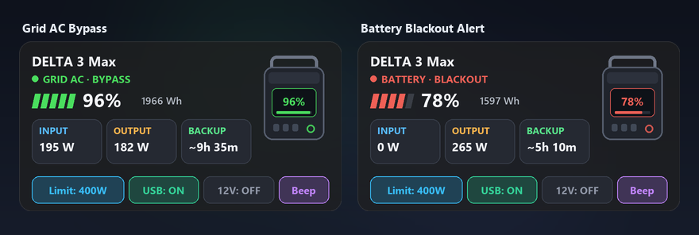

<div align="center">

# StartHub

**Turn your Windows 11 Start Menu into a modular, native-acrylic 3-panel command center.**

**English** · [Українська](README.uk.md) · [Русский](README.ru.md)

-0078D4?logo=windows11&logoColor=white)


<sub>2× supersampled UI rendered via Win32 <code>UpdateLayeredWindow</code> + DWM acrylic blur and 120ms cubic ease-out fade. Works with Stardock Start11, native Windows 11 Start Menu, or a global hotkey (<code>Alt+Space</code>).</sub>

</div>

---

## Why StartHub?

StartHub floats two synchronized, native-acrylic side wings beside your Windows 11 Start Menu (plus transparent center Weather/Clock overlays inside Start11) — **without replacing Explorer or burning background CPU**.

- **Works for everyone on Windows 11:** Tracks **Stardock Start11**, the **native Windows 11 Start Menu** (`StartMenuExperienceHost` + `DWMWA_CLOAKED`), or toggles anywhere via a **global hotkey (`Alt+Space`)**.
- **Full, useful dashboard out of the box (0 API keys):** Audio volume & 1-click output device switcher, universal SMTC media player, CPU/GPU (NVIDIA + AMD/Intel) & RAM monitor, disk storage & live network speed, Bluetooth/Xbox/Logitech peripherals, Open-Meteo weather (search city by name), local quick-tasks, Focus/Pomodoro timer, monthly calendar, and customizable Quick Actions.
- **Built-in GUI Settings (no JSON editing required):** Reorder any widget (`↑ ↓`), move cards between Left and Right wings (`← →`), switch layout presets (*Balanced*, *Minimal*, *Productivity*), search your weather city, sync your Windows accent color, or pair Philips Hue in 1 click.
- **Visibility-gated performance:** Heavy system/audio/media/Hue polling pauses completely when the panels are hidden — keeping idle CPU near **0%**.
- **Adaptive DPI & multi-monitor fit:** Automatically adjusts wing widths on 1080p / 125–150% DPI screens so panels never overlap your Start Menu.

---

## Out of the Box (Zero API Keys)

Install and run without creating a single account or API key — both wings are balanced and ready immediately:


---

## Multi-Accent, Single-Accent & 6 Built-In Theme Presets

Inspired by community feedback on `r/desktops` (shoutout to `u/kootenay_eric`!), customize **every single color** visually in GUI Settings:
- **6 built-in presets:** `Fluent Dark`, `Fluent Light` (frosted white), `AMOLED Pure Black`, `Catppuccin Mocha`, `Nord Frost`, and `Tokyo Night`.
- **Multi-Accent or Single-Accent** (including live Windows 11 DWM accent syncing via `"accent_color": "windows"`).
- **Custom surface & per-widget colors:** override panel background, tile fill, borders, text, or individual widget accents + **Export / Import** shareable theme profiles (zero secrets).
- Critical alerts (EcoFlow `BLACKOUT`, CPU/GPU/Disk `>90%`, low battery `≤15%`) always retain alert visibility.


<br><br>


Full color, widget, and Zero-Overlap guide: **[docs/CUSTOMIZATION.md](docs/CUSTOMIZATION.md)**

---

## Zero-Overlap Protection & Smooth Updates

- **Tiles can never break your widgets (and widgets never block tiles):** Start11 center Weather/Clock overlays are **100% click-through** (`WS_EX_TRANSPARENT`), verify live on-screen `LVM_GETITEMRECT` bounds with a configurable safety margin (`14px`), instantly yield on Start11 search, tile dragging, or right-click menus, and **automatically relocate Weather to the side wing** (`show_card: "auto"`) whenever pinned tiles fill the center space.
- **Update-proof configs:** Automatic schema migrations (`config_version: 2`), non-intrusive 24h GitHub Releases check, and 1-click **`Update.cmd`** that backs up `config.json` before pulling updates.

---

## Quick Start (2 Minutes)

### Option A — Portable Executable (No Python Required)
Download **`StartHub-v0.1.1-win64-portable.zip`** from [Releases](https://github.com/Alexsander720/starthub/releases), extract it anywhere, and double-click **`StartHub.exe`**.

### Option B — Source Install (Windows 11)
Download or clone the repo, then **double-click `Install.cmd`** (bypasses PowerShell ExecutionPolicy automatically), or run in PowerShell:

```powershell
git clone https://github.com/Alexsander720/starthub.git
cd starthub
.\install.ps1 -Optional -AutoStart
```

> No Python installed yet? Run `.\install.ps1 -InstallPython -Optional -AutoStart` to install Python 3.12 via `winget` automatically (skips Windows 11's fake Microsoft Store stub).

### Preview Immediately in Demo Mode (10 Seconds)

```powershell
.\.venv\Scripts\python.exe -m starthub --demo --preview
```

### Launch Live & Open GUI Settings

- Double-click **`StartHub.cmd`** (or run `.\.venv\Scripts\pythonw.exe -m starthub`).
- Press the **Windows key** (Start11 or native Windows 11 Start) — or press **`Alt+Space`** anywhere.
- Right-click the **StartHub tray icon → Settings...** to customize widgets, city, themes, and integrations live.

Full installation and troubleshooting guide: **[docs/SETUP.md](docs/SETUP.md)**.

---

## Widgets & Modules

### Tier 1 — Out of the Box (Zero API Keys)

| Widget | What it does |
|---|---|
| **Audio & Output Switcher** | Native Windows Core Audio master volume (10-step clickable bar), mute toggle, and **1-click output switching** (Headphones ⇄ Speakers ⇄ Monitor). |
| **System Monitor** | Visibility-gated CPU, GPU (**NVIDIA NVML / `nvidia-smi` + AMD/Intel Windows PDH**), GPU temp, and RAM. |
| **Storage & Network** | Auto-detected fixed drives (`C:`, `D:`, `E:`) with free space & usage alerts + live Download / Upload throughput. |
| **Media Player (SMTC)** | Works with **any** Windows player (Spotify, YouTube Music, Tidal, Chrome/Edge, VLC) — album art, source badge, progress bar, transport controls, and optional Spotify PKCE heart. |
| **Peripherals & Bluetooth** | Windows Bluetooth/BLE PnP battery levels (AirPods, Sony WH-1000, MX Master BT, Keychron), **Xbox / XInput**, DualSense (HID/DSX), Logitech HID++ (Unifying, Bolt, Lightspeed), and interactive BT drawer + radio toggle. |
| **Tasks (Local / Todoist)** | Offline local checklist out of the box (`+` to add, 1-click complete) — seamlessly upgrades to **Todoist REST API v1** when a token is added. |
| **Focus / Pomodoro Timer** | 25/5 Focus & Break countdown with Play/Pause, Reset, session counter, and completion chime. |
| **Weather & Calendar** | Free Open-Meteo weather with **city search by name** (no manual coordinates), smart `"show_card": "auto"` deduplication, transparent Start11 center overlays, and interactive monthly calendar. |
| **Quick Actions** | Customizable 1-click bar (Snipping Tool, Windows Terminal, Lock PC, StartHub Settings, or custom commands/URLs). |

### Tier 2 — Opt-In Power Modules (`enabled: false` by default)

| Widget | What it does |
|---|---|
| **EcoFlow Power Station** | Live **DELTA 3 / DELTA 2** Cloud MQTT (TLS 8883 + Protobuf/JSON) or state-file telemetry: Grid Bypass vs Blackout alerts, 5-segment SoC, Input/Output/Backup runtime, and direct buttons (Charge Limit, USB, 12V DC, Beep). |
| **Smart Lights (Hue / HA / WLED)** | Universal local control for **Philips Hue** (1-click Bridge discovery & pairing), **Home Assistant** (Xiaomi/Yeelight, Tuya, Aqara, IKEA, Tapo, Govee, Zigbee), and **WLED** LED strips — 1–4 tiles + Right-Click dimmer selection. |
| **Android Phone Hub (ADB)** | Sleek vector chassis (or custom PNG), battery pill, 1-click `scrcpy` screen mirror, instant phone screenshot straight to Windows clipboard (`Ctrl+V`), collapsible recent photos + gallery modal, and opt-in SMS/2FA OTP bar. |
| **Custom JSON Cards** | Universal widget supporting **`columns`**, **`hero`**, and **`list`** layouts from any local JSON file or `localhost` URL — includes ready-to-run scripts in [`examples/custom_json/`](examples/custom_json/). |
| **Start11 Tile Switcher** | Atomic switcher for user-created Start11 tile packs with automatic `.reg` backup & rollback. |

<div align="center">

<br><br>

</div>

Step-by-step setup guides:
- **[docs/WIDGETS.md](docs/WIDGETS.md)** ([Русская версия](docs/WIDGETS.ru.md)) — complete walkthroughs for **[Android Phone Hub (ADB + Wi-Fi + scrcpy + SMS/2FA)](docs/WIDGETS.md#2-android-phone-hub--adb-wi-fi-adb-scrcpy-photos--sms2fa-phone_adb)**, **[EcoFlow DELTA 3/2 MQTT](docs/WIDGETS.md#3-ecoflow-power-station--delta-3--delta-2-cloud-mqtt--state-file-ecoflow)**, **[AI Agent Quotas & Budget Custom JSON](docs/WIDGETS.md#4-ai-agent-quotas-budgets--custom-json-cards-custom_json)**, **[Smart Lights (Hue / HA / WLED)](docs/WIDGETS.md#5-smart-lights--philips-hue-home-assistant--wled-philips_hue)**, **[Todoist](docs/WIDGETS.md#6-tasks--todoist-tasks--todoist)**, **[Spotify Heart](docs/WIDGETS.md#7-spotify-liked-songs-heart-spotify_like)**, and **[Start11 Tile Packs](docs/WIDGETS.md#8-start11-tile-pack-switcher-tile_switcher)**.
- **[docs/CUSTOMIZATION.md](docs/CUSTOMIZATION.md)** — themes, custom colors, GUI builders & Zero-Overlap protection · **[docs/CREATING_WIDGETS.md](docs/CREATING_WIDGETS.md)** — build your own Python widget.

---

## Privacy, Diagnostics & Development

- **Zero-leak architecture:** `config.json`, `.env`, tokens, and caches are git-ignored. GUI Settings uses non-destructive patching so `${ENV_VAR}` placeholders are never overwritten with expanded secrets.
- **Sanitized Diagnostics (`--doctor`):** Run `python -m starthub --doctor` or click **Tray → Copy Diagnostics Report** to generate a clean, secret-free environment summary for bug reports.
- **Automated quality gates:**

```powershell
python tools/scan_private.py   # Strictly 0 findings
pytest -v                      # Full unit & visual render suite
python -m starthub --doctor    # Environment check
```

---

## Support

StartHub is free and open-source (MIT). If it upgraded your Windows 11 desktop and you'd like to support ongoing development:

<table align="center"><tr>
<td align="center"><br><b>monobank jar</b></td>
<td align="center"><br><b>USDT · TRC20</b></td>
<td align="center"><br><b>USDT · BEP20</b></td>
</tr></table>

- **monobank jar** — <https://send.monobank.ua/jar/3zsHTXdRbt> · jar card `4874 1000 3320 3608`
- **USDT · TRC20** (Tron) — `TKhmtVEnuU5w73YMPT8adh7t3VZKJUUxmC`
- **USDT · BEP20** (BNB Smart Chain) — `0xDC0c682922bF3194693774743fBB3fd20E7754c3`

---

## License

Code is licensed under the **[MIT License](LICENSE)**.

StartHub is an independent open-source project and is not affiliated with Microsoft, Stardock, EcoFlow, Signify (Philips Hue), Spotify, or Doist (Todoist).

<div align="center"><sub>Made in Ukraine by <a href="https://github.com/Alexsander720">@Alexsander720</a></sub></div>
