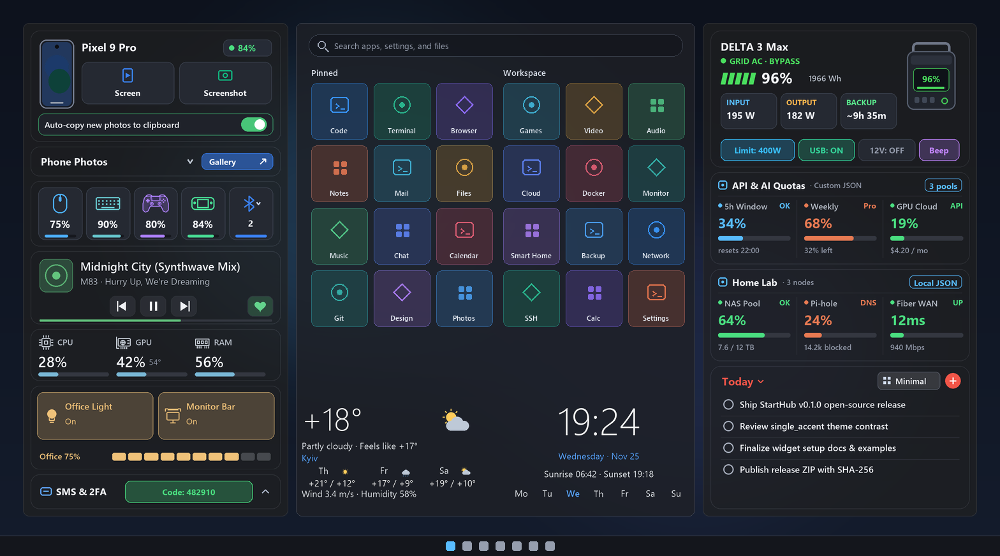
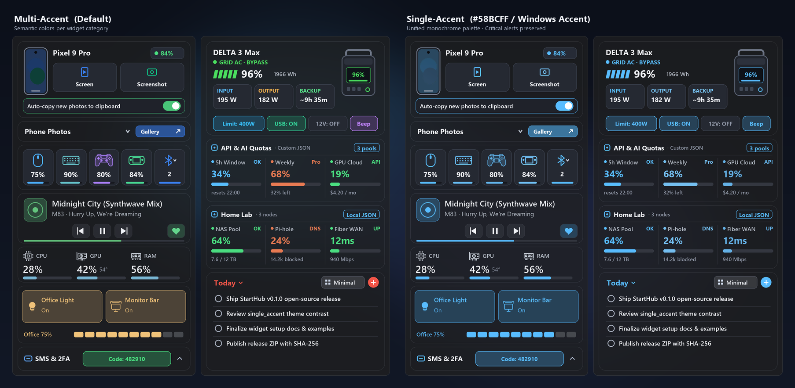

<div align="center">

# StartHub

**Turn your Windows 11 + Start11 menu into a modular, native-acrylic 3-panel command center.**




<sub>Rendered directly from <code>python -m starthub --demo</code> with native 2x supersampled UI. Works out of the box with zero API keys.</sub>

</div>

---

## Why StartHub?

StartHub floats two synchronized native-acrylic side panels (and optional transparent center weather/clock overlays) alongside **Stardock Start11** (`DV2ControlHost`) using Win32 `UpdateLayeredWindow` + DWM blur-behind and rounded corners.

- **Instant visibility-gated performance:** Heavy system/media/Hue polling runs **only while your Start menu is open** — keeping idle background CPU usage near **0%**.
- **Works in 2 minutes with zero API keys (Tier 1):** System Monitor (CPU / GPU + temp / RAM), universal Windows SMTC media player, wireless peripherals + Bluetooth drawer, Open-Meteo weather, and interactive calendar work immediately out of the box.
- **Modular opt-in power widgets (Tier 2):** Enable Philips Hue, Todoist, Android ADB (`scrcpy` + clipboard screenshots + optional 2FA/SMS bar), EcoFlow DELTA 3 / DELTA 2 Cloud MQTT telemetry, Start11 Tile Pack Switcher, or your own **Custom JSON** cards in one config block.
- **Try everything in 10 seconds (`--demo`):** Preview all widgets live with realistic synthetic data before configuring a single key.

---

## Multi-Accent vs Single-Accent Theme

Based on community feedback from `r/desktops` (shoutout to `u/kootenay_eric`!), StartHub ships with both **`multi_accent`** and **`single_accent`** themes — including automatic Windows 11 DWM AccentColor syncing (`"accent_color": "windows"`). Critical alerts (EcoFlow `BLACKOUT`, CPU/GPU `>90%`, critically low battery) always retain alert visibility.



Switch themes on the fly from the **system tray icon**, CLI (`--theme single_accent`), or `config.json`:

```json
"theme": {
  "mode": "single_accent",
  "accent_color": "windows",
  "panel_alpha": 180,
  "blur": true,
  "corner_radius": 14
}
```

---

## Quick Start (2 Minutes)

### 1. Clone & Install

```powershell
git clone https://github.com/Alexsander720/starthub.git
cd starthub
.\install.ps1
```

Want GPU NVML, wireless HID++ battery polling, and EcoFlow MQTT/Protobuf? Pass `-Optional` (and `-AutoStart` to add a Startup shortcut):

```powershell
.\install.ps1 -Optional -AutoStart
```

### 2. Preview Immediately in Demo Mode (No Keys Needed)

```powershell
.\.venv\Scripts\python.exe -m starthub --demo --preview
```

Or test single-accent mode / Ukrainian / Russian localization directly:

```powershell
.\.venv\Scripts\python.exe -m starthub --demo --preview --theme single_accent --lang en
```

### 3. Launch Live with Start11

```powershell
.\.venv\Scripts\pythonw.exe -m starthub
```

Press the **Windows key** — StartHub snaps cleanly to both sides of Start11 and hides automatically when Start11 closes. Right-click the **StartHub tray icon** to reload config, switch themes, toggle Demo mode, pause tracking, or open `config.json`.

For full installation details and troubleshooting, see **[docs/SETUP.md](docs/SETUP.md)**.

---

## Widgets Overview

### Tier 1 — Out of the Box (Zero API Keys)

| Widget | What it does |
|---|---|
| **System Monitor** | Live CPU, NVIDIA GPU (+ temp via NVML or `nvidia-smi`), and RAM with visibility-gated polling. |
| **Media Player (SMTC)** | Works with **any** Windows media player (Spotify, YouTube Music, Tidal, Chrome/Edge, VLC) — album art, progress bar, transport controls, and optional Spotify PKCE Like heart. |
| **Peripherals & Bluetooth** | Wireless mouse, Logitech HID++ keyboard, DualSense (HID or DSX UDP), optional handheld JSON file, and an interactive Windows Bluetooth drawer + radio toggle. |
| **Weather & Clock** | Free Open-Meteo weather (no API key) + live transparent center overlays beneath Start11 tiles + optional wing Weather & Calendar cards. |

### Tier 2 — Opt-In Modules (`enabled: false` by default)

| Widget | What it does |
|---|---|
| **EcoFlow Power Station** | Live **DELTA 3 / DELTA 2** Cloud MQTT (TLS 8883 + Protobuf/JSON) telemetry: Grid Bypass vs Blackout alerts, 5-segment SoC, Input/Output/Backup runtime, and direct hardware buttons (AC Charge Limit, USB, 12V DC, Beep). |
| **Philips Hue** | Local LAN HTTPS control for configured rooms/lights + clickable 10-step brightness dimmer bar. |
| **Android Phone (ADB)** | Clean vector phone preview (or custom PNG), battery pill, 1-click `scrcpy` screen mirror, instant phone screenshot straight to Windows clipboard (`Ctrl+V`), collapsible recent photos + gallery modal, and opt-in SMS / 2FA OTP bar. |
| **Todoist** | Project switcher and 1-click task completion via Todoist REST API v1 (`${TODOIST_API_TOKEN}`). |
| **Custom JSON Cards** | Universal 1–3 metric card reading any local JSON file or `localhost` URL — plug in Home Assistant, Pi-hole, AI quota scripts, NAS health, crypto/FX rates, or anything else. |
| **Start11 Tile Switcher** | Optional header pill & CLI (`tools/tile_switcher.py`) to atomically swap user-created Start11 tile packs with automatic `.reg` backup and rollback. |

Full setup instructions for every Tier 2 module are in **[docs/WIDGETS.md](docs/WIDGETS.md)**.

<div align="center">

</div>

---

## Privacy, Security & Development

- **Secrets stay out of Git:** `config.json`, `.env`, tokens, and caches are git-ignored. Use `${ENV_VAR}` placeholders inside `config.json` (e.g. `${TODOIST_API_TOKEN}`, `${HUE_APP_KEY}`, `${ECOFLOW_PASSWORD}`).
- **Automated leak scanner:** Every CI run executes `python tools/scan_private.py` to block accidental commits of personal paths, LAN IPs, serials, or tokens.
- **Run local verification:**

```powershell
python tools/scan_private.py
pytest -v
python tools/render_demo.py
```

---

## Support

StartHub is free and open-source (MIT). If it upgraded your Windows 11 desktop and you'd like to support ongoing development:

<table align="center"><tr>
<td align="center"><br><b>monobank jar</b></td>
<td align="center"><br><b>USDT · TRC20</b></td>
<td align="center"><br><b>USDT · BEP20</b></td>
</tr></table>

- **monobank jar** — <https://send.monobank.ua/jar/3zsHTXdRbt> · jar card `4874 1000 3320 3608`
- **USDT · TRC20** (Tron) — `TKhmtVEnuU5w73YMPT8adh7t3VZKJUUxmC`
- **USDT · BEP20** (BNB Smart Chain) — `0xDC0c682922bF3194693774743fBB3fd20E7754c3`

---

## License

Code is licensed under the **[MIT License](LICENSE)**.

StartHub is an independent open-source project and is not affiliated with Microsoft, Stardock, EcoFlow, Signify (Philips Hue), Spotify, or Doist (Todoist).

<div align="center"><sub>Made in Ukraine by <a href="https://github.com/Alexsander720">@Alexsander720</a></sub></div>
