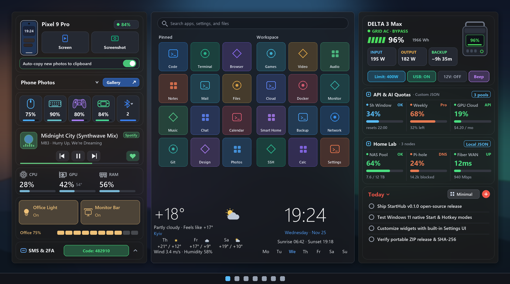
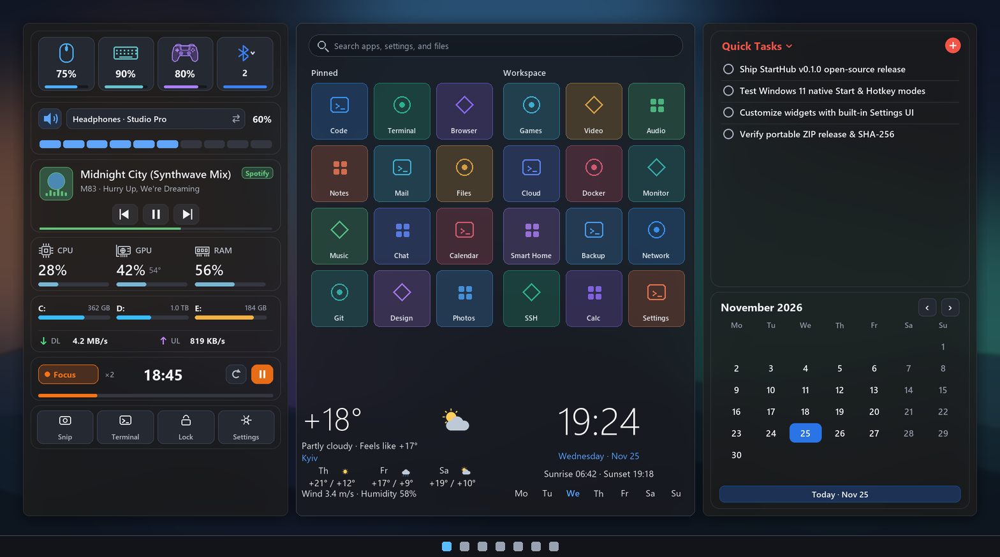
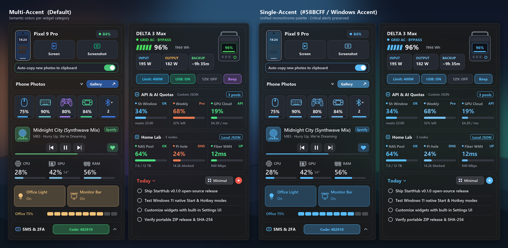
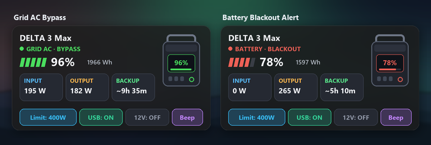

# StartHub

**Превратите меню «Пуск» Windows 11 в модульный 3-панельный командный центр с нативным акриловым блюром.**

[English](README.md) · [Українська](README.uk.md) · **Русский**

-0078D4?logo=windows11&logoColor=white)

Рендер в 2× суперсемплинге через Win32 <code>UpdateLayeredWindow</code> + нативный DWM acrylic blur и плавную 120ms анимацию появления. Работает со Stardock Start11, обычным «Пуском» Windows 11 или по глобальному хоткею (<code>Alt+Space</code>).

---

## Почему StartHub?

- **Подходит всем на Windows 11:** поддерживает **Stardock Start11**, **штатный «Пуск» Windows 11** (`StartMenuExperienceHost`) или вызов в любой момент по **`Alt+Space`** (без покупки Start11).
- **Полноценный комбайн «из коробки» (0 API-ключей):** громкость и переключение аудиовыходов в 1 клик, универсальный медиаплеер Windows SMTC, монитор CPU/GPU (NVIDIA + AMD/Intel) и RAM, диски и скорость сети, батареи Bluetooth/Xbox/Logitech, погода Open-Meteo с поиском города по названию, локальный список задач, таймер Фокус/Pomodoro, календарь и быстрые действия.
- **Встроенные GUI-настройки:** включайте, переставляйте (`↑ ↓`) и переносите любые виджеты между левым и правым крылом (`← →`), меняйте пресеты, синхронизируйте акцентный цвет Windows или подключайте Philips Hue в 1 клик — без ручной правки JSON.
- **Почти 0% нагрузки в фоне:** опрос системы, аудио, медиа и Hue работает **только пока открыто меню**.
- **Адаптация под 1080p и 125–150% DPI:** крылья автоматически подстраивают ширину и никогда не залезают на «Пуск».

---

## Как выглядит сразу после установки (0 API-ключей)

---

## Multi-Accent и Single-Accent

Мгновенное переключение между семантической палитрой и монохромным `single_accent` (с автоподхватом системного акцента Windows 11). Критические алерты (`БЛЭКАУТ` EcoFlow, CPU/GPU/диск `>90%`, заряд `≤15%`) всегда остаются красными.

---

## Быстрый старт

1. **Портативная версия (без Python):** скачайте `StartHub-v0.1.0-win64-portable.zip` из [Releases](https://github.com/Alexsander720/starthub/releases), распакуйте и запустите **`StartHub.exe`**.
2. **Из исходников:** клонируйте репозиторий и дважды кликните **`Install.cmd`** (или выполните `.\install.ps1 -Optional -AutoStart` в PowerShell).
3. **Посмотреть демо за 10 секунд:** `.\.venv\Scripts\python.exe -m starthub --demo --preview`.
4. **Запуск в фоне:** дважды кликните **`StartHub.cmd`**, нажмите **Win** или **`Alt+Space`**. Настройки — в меню иконки трея (**Настройки...**).

Подробные гайды: **[docs/SETUP.md](docs/SETUP.md)** · **[docs/WIDGETS.md](docs/WIDGETS.md)** · **[docs/CREATING_WIDGETS.md](docs/CREATING_WIDGETS.md)**.

---

## Опциональные модули (Tier 2)

- **EcoFlow DELTA 3 / DELTA 2** — Cloud MQTT (TLS 8883 + Protobuf/JSON) с алертами `БЛЭКАУТ`, лимитом зарядки, USB/12V/Звук.
- **Philips Hue** — локальный LAN HTTPS + автопоиск моста и привязка в 1 клик прямо из настроек.
- **Android Phone Hub (ADB)** — экран `scrcpy`, скриншот телефона сразу в буфер Windows (`Ctrl+V`), галерея фото и опциональный бар SMS/2FA.
- **Todoist** — синхронизация проектов и закрытие задач в 1 клик.
- **Custom JSON** — 3 режима вёрстки (`columns`, `hero`, `list`) + готовые скрипты в [`examples/custom_json/`](examples/custom_json/).
- **Start11 Tile Switcher** — переключение пользовательских паков плиток с автоматическим бекапом `.reg`.

---

## Поддержка проекта

StartHub бесплатен и открыт (MIT). Если он прокачал ваш рабочий стол Windows 11:

<table align="center"><tr>
<td align="center"> <b>monobank банка</b></td>
<td align="center"> <b>USDT · TRC20</b></td>
<td align="center"> <b>USDT · BEP20</b></td>
</tr></table>

- **monobank банка** — <https://send.monobank.ua/jar/3zsHTXdRbt> · карта банки `4874 1000 3320 3608`
- **USDT · TRC20** (Tron) — `TKhmtVEnuU5w73YMPT8adh7t3VZKJUUxmC`
- **USDT · BEP20** (BNB Smart Chain) — `0xDC0c682922bF3194693774743fBB3fd20E7754c3`

Сделано в Украине · <a href="https://github.com/Alexsander720">@Alexsander720</a> · MIT License

