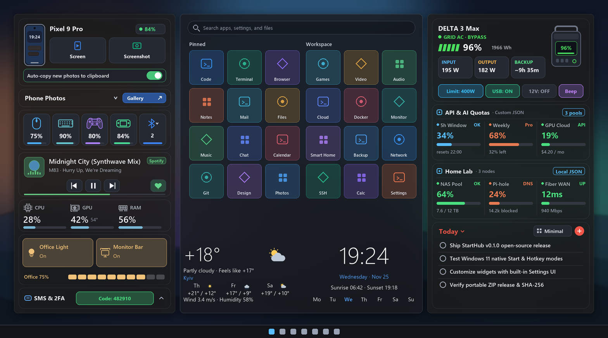
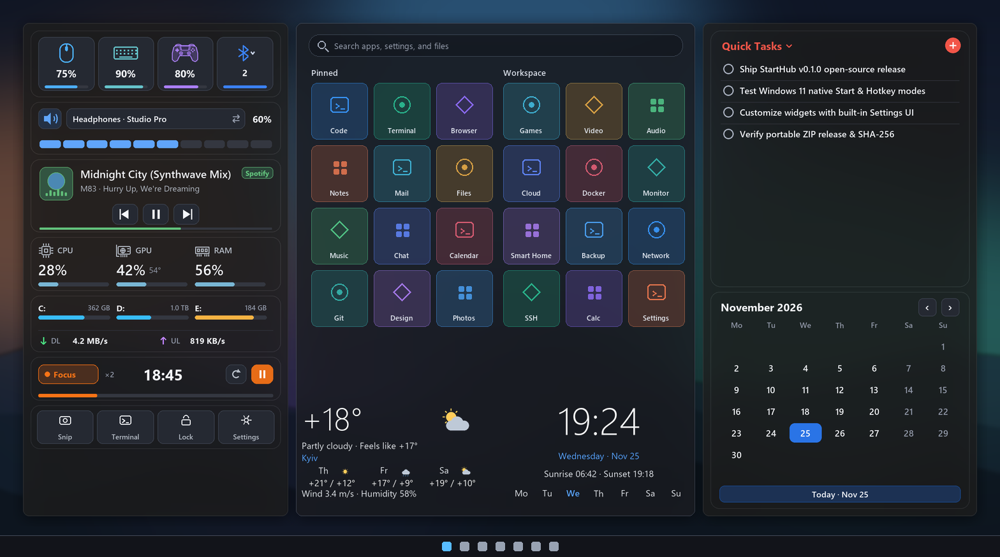
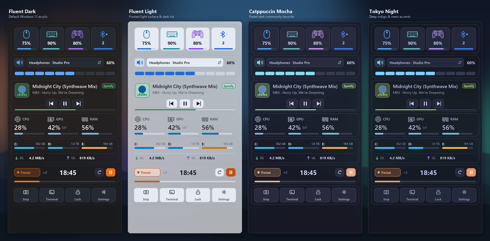
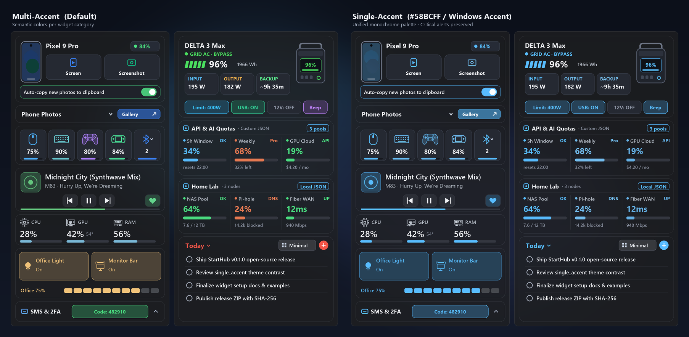
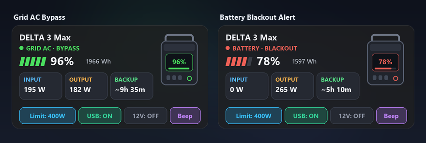

# StartHub

**Перетворіть меню «Пуск» Windows 11 на модульний 3-панельний командний центр із нативним акриловим блюром.**

[English](README.md) · **Українська** · [Русский](README.ru.md)

-0078D4?logo=windows11&logoColor=white)

Рендер у 2× суперсемплінгу через Win32 <code>UpdateLayeredWindow</code> + нативний DWM acrylic blur і плавну 120ms анімацію появи. Працює зі Stardock Start11, стандартним меню «Пуск» Windows 11 або за гарячою клавішею (<code>Alt+Space</code>).

---

## Чому StartHub?

- **Працює для всіх на Windows 11:** підтримує **Stardock Start11**, **рідне меню «Пуск» Windows 11** (`StartMenuExperienceHost`) або миттєвий виклик з будь-якого місця за **`Alt+Space`** (без покупки Start11).
- **Повноцінна панель «з коробки» (0 API-ключів):** керування гучністю й перемикач аудіовиходів у 1 клік, універсальний медіаплеєр Windows SMTC, монітор CPU/GPU (NVIDIA + AMD/Intel) і RAM, диски та швидкість мережі, батареї Bluetooth/Xbox/Logitech, погода Open-Meteo з пошуком міста за назвою, локальний чекліст завдань, таймер Фокус/Pomodoro, календар і швидкі дії.
- **Вбудовані GUI-налаштування:** вмикайте, сортуйте (`↑ ↓`) та переносьте будь-які віджети між лівим і правим крилом (`← →`), перемикайте пресети, синхронізуйте акцентний колір Windows або прив’язуйте Philips Hue в 1 клік — без ручного редагування JSON.
- **Нульове навантаження у фоні:** важкий опитувач системи, аудіо, медіа й Hue працює **лише поки відкрито меню**.
- **Адаптація під 1080p та 125–150% DPI:** крила автоматично підлаштовують ширину й ніколи не перекривають «Пуск».

---

## Як виглядає одразу після встановлення (0 API-ключів)

---

## 6 вбудованих тем, будь-які кольори та захист від перекриття плиток

- **6 готових тем в 1 клік:** `Fluent Dark`, `Fluent Light` (світле матове скло), `AMOLED Pure Black`, `Catppuccin Mocha`, `Nord Frost` та `Tokyo Night` — плюс режим `Multi-Accent` / `Single-Accent` (із підхопленням акценту Windows 11).
- **Повна свобода кольорів і віджетів у GUI:** перефарбовуйте фон, плитки, межі, текст і колір кожного віджета окремо, додавайте власні кнопки **Quick Actions** та картки **Custom JSON**, експортуйте й діліться профілем (без секретів).
- **Плитки ніколи не ламають віджети:** центр-оверлеї Погоди/Годинника в Start11 повністю **прозорі для кліків (`WS_EX_TRANSPARENT`)**, звіряють реальні координати всіх плиток + запас `14px`, миттєво поступаються пошуку/контекстним меню й **автоматично переносять Погоду у бокове крило**, якщо плиток стало більше.
- **Безпечні оновлення:** авто-міграція схеми `config.json`, ненав’язлива перевірка релізів та 1-клік **`Update.cmd`** з автобекапом конфіга.

  

Повний гід із кастомізації та захисту від плиток: **[docs/CUSTOMIZATION.md](docs/CUSTOMIZATION.md)**

---

## Швидкий старт

1. **Портативна версія (без Python):** завантажте `StartHub-v0.1.1-win64-portable.zip` із [Releases](https://github.com/Alexsander720/starthub/releases), розпакуйте та запустіть **`StartHub.exe`**.
2. **Із вихідного коду:** клонуйте репозиторій та двічі клікніть **`Install.cmd`** (або виконайте `.\install.ps1 -Optional -AutoStart` у PowerShell).
3. **Миттєвий перегляд демо:** `.\.venv\Scripts\python.exe -m starthub --demo --preview`.
4. **Запуск у фоні:** двічі клікніть **`StartHub.cmd`**, натисніть **Win** або **`Alt+Space`**. Налаштування відкриваються через іконку в треї (**Налаштування...**).

Детальна документація: **[docs/SETUP.md](docs/SETUP.md)** · **[docs/WIDGETS.md](docs/WIDGETS.md)** ([RU](docs/WIDGETS.ru.md)) · **[docs/CUSTOMIZATION.md](docs/CUSTOMIZATION.md)** · **[docs/CREATING_WIDGETS.md](docs/CREATING_WIDGETS.md)**.

---

## Опційні модулі (Tier 2)

- **EcoFlow DELTA 3 / DELTA 2** — Cloud MQTT (TLS 8883 + Protobuf/JSON) із миттєвими алертами `БЛЕКАУТ`, лімітом зарядки, USB/12V/Звук ([гайд](docs/WIDGETS.md#3-ecoflow-power-station--delta-3--delta-2-cloud-mqtt--state-file-ecoflow)).
- **Розумне світло (Hue / Home Assistant / WLED)** — локальне керування **Philips Hue**, **Home Assistant** (Xiaomi/Yeelight, Tuya, Aqara, IKEA, Tapo, Govee, Zigbee) та Wi-Fi стрічками **WLED** (1–4 плитки + димер по ПКМ) ([гайд](docs/WIDGETS.md#5-smart-lights--philips-hue-home-assistant--wled-philips_hue)).
- **Android Phone Hub (ADB)** — Wi-Fi ADB + екран `scrcpy`, скріншот телефону одразу в буфер Windows (`Ctrl+V`), галерея фото та опційна панель SMS/2FA ([покроковий гайд](docs/WIDGETS.md#2-android-phone-hub--adb-wi-fi-adb-scrcpy-photos--sms2fa-phone_adb)).
- **Todoist** — синхронізація проєктів і закриття завдань у 1 клік ([гайд](docs/WIDGETS.md#6-tasks--todoist-tasks--todoist)).
- **Ліміти ШІ-агентів, трекери та Custom JSON** — 3 готові макети (`columns`, `hero`, `list`) + скрипти `ai_quotas_example.py` і `income_budget_example.py` у [`examples/custom_json/`](examples/custom_json/) ([гайд](docs/WIDGETS.md#4-ai-agent-quotas-budgets--custom-json-cards-custom_json)).
- **Start11 Tile Switcher** — перемикання користувацьких паків плиток із бекапом `.reg` ([гайд](docs/WIDGETS.md#8-start11-tile-pack-switcher-tile_switcher)).

---

## Підтримка проєкту

StartHub — безкоштовний проєкт із відкритим кодом (MIT). Якщо він зробив ваш робочий стіл зручнішим:

<table align="center"><tr>
<td align="center"> <b>monobank банка</b></td>
<td align="center"> <b>USDT · TRC20</b></td>
<td align="center"> <b>USDT · BEP20</b></td>
</tr></table>

- **monobank банка** — <https://send.monobank.ua/jar/3zsHTXdRbt> · картка банки `4874 1000 3320 3608`
- **USDT · TRC20** (Tron) — `TKhmtVEnuU5w73YMPT8adh7t3VZKJUUxmC`
- **USDT · BEP20** (BNB Smart Chain) — `0xDC0c682922bF3194693774743fBB3fd20E7754c3`

Створено в Україні · <a href="https://github.com/Alexsander720">@Alexsander720</a> · MIT License

