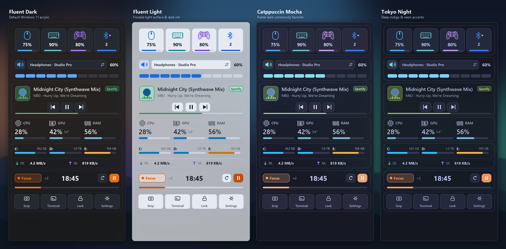

# StartHub Complete Customization Guide

Every part of StartHub — widgets, wing placement, theme presets, surface colors, per-widget accent roles, Quick Actions, Custom JSON cards, Start Menu trigger, and update handling — can be configured either visually in **Tray → Settings...** or in `config.json`.

---

## 1. Visual Theme Presets & Unlimited Color Customization

StartHub ships with **6 built-in theme presets** selectable in 1 click under **Settings → Themes & Triggers** (or via CLI `--preset`):

| Preset ID | Aesthetic | Mode |
|---|---|---|
| `fluent_dark` | Native Windows 11 Dark Acrylic (default) | Dark |
| `fluent_light` | Frosted Windows 11 Light Acrylic with crisp dark ink | Light |
| `amoled_black` | Pure OLED black (`#0A0B0E`) with subtle borders | Dark |
| `catppuccin_mocha` | Catppuccin Mocha pastel dark palette | Dark |
| `nord` | Scandinavian frost blue-slate palette | Dark |
| `tokyo_night` | Deep indigo & neon Tokyo Night palette | Dark |



### Changing ANY Surface or Per-Widget Color

You don't have to stop at presets. Under **Settings → Themes & Triggers → Custom Surface & Per-Widget Colors** (or in `config.json`):

```json
"theme": {
  "preset": "catppuccin_mocha",
  "mode": "multi_accent",
  "accent_color": "windows",
  "panel_alpha": 185,
  "blur": true,
  "corner_radius": 14,
  "custom_colors": {
    "panel_bg": "#181825",
    "tile_bg": "#24273A",
    "border": "#494D64",
    "text_primary": "#CAD3F5",
    "text_secondary": "#A5ADCB"
  },
  "role_overrides": {
    "media": "#F5C2E7",
    "audio": "#89DCEB",
    "focus_work": "#FAB387",
    "todoist": "#F38BA8"
  }
}
```

- Leave any key inside `custom_colors` empty (`""`) to inherit from the active `preset`.
- Set `"accent_color": "windows"` to sync dynamically with your Windows 11 DWM system accent.
- Switch `"mode": "single_accent"` to unify all widget accents around a single color while still keeping critical alerts red/amber (`BLACKOUT`, CPU/GPU/Disk `>90%`, battery `≤15%`).

### Sharing Profiles (Zero Secrets)

Click **Export Profile...** at the bottom of Settings to save a clean JSON containing **only** your `theme`, `window`, and `layout` (strictly zero API tokens, passwords, IPs, or personal paths). Anyone can apply it via **Import Profile...**.

---

## 2. Adding, Removing, and Reordering ANY Widget

Open **Settings → Widgets & Layout**:

- **Quick Layout Presets:** 1 click switches between *Balanced (Default)*, *Minimal*, and *Productivity*.
- **Toggle anything:** Uncheck any widget to remove it; check any Tier 1 or Tier 2 widget to add it.
- **Reorder & Move Across Wings:** Use `↑` / `↓` to change vertical order and `←` / `→` to move any widget between Left Wing and Right Wing.
- **Single-Wing Mode:** Click **Disable All** on either wing — StartHub automatically hides the empty wing so only your chosen side appears.

---

## 3. Building Your Own Buttons & Custom Metric Cards

Open **Settings → Custom Cards & Actions**:

### Custom Quick Actions (Up to 5 Buttons)
Add your own 1-click launchers to the Quick Actions bar:
- **Built-in actions:** `snip` (Windows Snipping Tool), `terminal` (Windows Terminal), `lock` (Lock PC), `sleep` (Sleep), `explorer`, `starthub_settings`
- **Any URL:** e.g. `https://github.com` or `http://127.0.0.1:8123` (Home Assistant)
- **Any Windows app or command:** e.g. `calc.exe`, `notepad.exe`, `code`

### Custom JSON Cards (`columns` / `hero` / `list`)
Turn any local JSON file or `localhost` endpoint into a native-acrylic card directly in the UI — see ready-to-run Python scripts in [`examples/custom_json/`](../examples/custom_json/README.md).

---

## 4. Zero-Overlap Guarantee for Start11 Tiles (Center Weather & Clock)

If you use Start11 in Windows 10 tile mode, StartHub can float transparent Weather & Clock overlays in the open area beneath your pinned tile groups — engineered so **tiles and widgets can never break or block each other**:

1. **100% Click-Through (`WS_EX_TRANSPARENT`):** Center overlays never capture mouse clicks, so they can never block a tile, folder, or scrollbar underneath.
2. **Double Collision Verification (Registry + Live Native Bounds):** Before showing Weather/Clock, StartHub verifies every tile's real on-screen `LVM_GETITEMRECT` coordinates plus a configurable **Tile Safety Margin** (`window.center_overlay_safety_margin`, default `14px`).
3. **Instant Yield on Search, Popups & Dragging:** Typing in Start11 search, opening a right-click context menu (`#32768`), dragging a tile, scrolling, or opening a tile popup hides the center overlays on the very next frame.
4. **Automatic Relocation to Side Wing:** If you add more rows of tiles and space beneath them drops below the safe threshold (or if a future Start11 update changes the tile view), center overlays cleanly disable themselves — and with `weather.show_card: "auto"`, Weather **automatically moves into the side wing** with zero overlap!
5. **Prefer never touching Start11's center?** Simply uncheck **Start11 Center Weather/Clock** in Settings (`"center_overlay": false`).

---

## 5. Safe Updates & Forward Compatibility

StartHub is built to survive future updates of both StartHub itself and Windows 11 / Start11:

- **Automatic Config Schema Migration:** `config.json` includes `"config_version": 2`. Future StartHub updates migrate old configs automatically in memory and on save without losing your settings or `${ENV_VAR}` placeholders.
- **1-Click Safe Updater (`Update.cmd`):** Double-click **`Update.cmd`** (or run `.\update.ps1 -Optional`). It backs up `config.json` into `cache/backups/`, pulls updates, refreshes `.venv`, and leaves your `config.json`, `cache/local_tasks.json`, and `packs/` untouched.
- **Portable EXE Updates:** Download the newer `StartHub-vX.Y.Z-win64-portable.zip`, extract it, and copy your `config.json` (plus optional `cache/local_tasks.json` and `packs/`) into the new folder.
- **Non-Intrusive Update Check:** Checks GitHub Releases at most once every 24 hours (disable anytime via **Settings → Diagnostics & Updates → Auto-check**). StartHub never downloads or executes code automatically.
