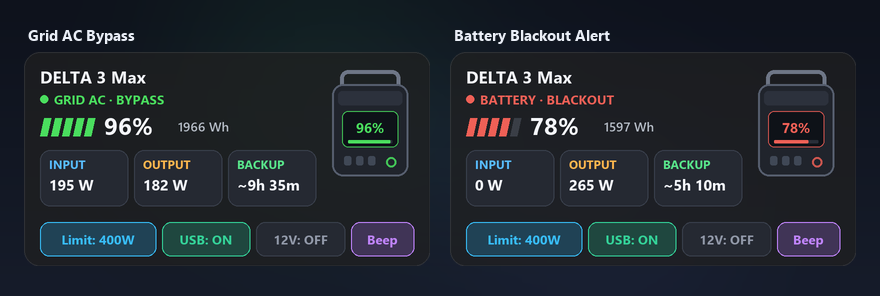
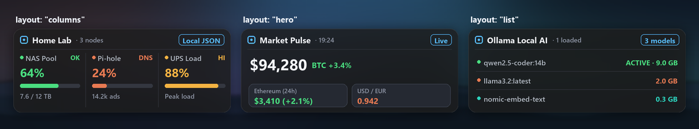

# StartHub Complete Widget & Integration Guide

> **Русская версия:** [docs/WIDGETS.ru.md](WIDGETS.ru.md) · **Themes & UI Customization:** [docs/CUSTOMIZATION.md](CUSTOMIZATION.md)

All **Tier 1** widgets work out of the box with **zero API keys**. All **Tier 2** modules are opt-in (`"enabled": false` by default) and support `${ENV_VAR}` placeholders so secrets never sit in plaintext inside `config.json`.

---

## Table of Contents
1. [Tier 1 Out-of-the-Box Widgets (Zero Keys)](#1-tier-1-out-of-the-box-widgets-zero-keys)
2. [Android Phone Hub — ADB, Wi-Fi ADB, scrcpy, Photos & SMS/2FA (`phone_adb`)](#2-android-phone-hub--adb-wi-fi-adb-scrcpy-photos--sms2fa-phone_adb)
3. [EcoFlow Power Station — DELTA 3 / DELTA 2 Cloud MQTT & State File (`ecoflow`)](#3-ecoflow-power-station--delta-3--delta-2-cloud-mqtt--state-file-ecoflow)
4. [AI Agent Quotas, Budgets & Custom JSON Cards (`custom_json`)](#4-ai-agent-quotas-budgets--custom-json-cards-custom_json)
5. [Philips Hue Smart Lights (`philips_hue`)](#5-philips-hue-smart-lights-philips_hue)
6. [Tasks & Todoist (`tasks` / `todoist`)](#6-tasks--todoist-tasks--todoist)
7. [Spotify Liked Songs Heart (`spotify_like`)](#7-spotify-liked-songs-heart-spotify_like)
8. [Start11 Tile Pack Switcher (`tile_switcher`)](#8-start11-tile-pack-switcher-tile_switcher)

---

## 1. Tier 1 Out-of-the-Box Widgets (Zero Keys)

| Widget ID | Controls & Features | Key Settings |
|---|---|---|
| `audio_control` | **Left-click speaker:** Mute/Unmute · **Click volume bar:** 10%–100% · **Click device pill (`⇄`):** cycle Headphones ⇄ Speakers ⇄ Monitor via native Windows Core Audio COM. | Enabled by default; zero extra packages. |
| `system_monitor` | Visibility-gated CPU, GPU (**NVIDIA NVML / `nvidia-smi` + AMD/Intel Windows PDH**), GPU temp, and RAM. | `poll_interval_sec: 2.0`. Bars turn amber `>70%` and red `>90%`. |
| `storage_network` | Auto-detected fixed drives (`C:`, `D:`, `E:`) with free space + live Download/Upload speed. | `drives: ["auto"]` or explicit `["C:", "D:"]`, `max_drives: 3`. |
| `media_player` | Universal Windows SMTC (Spotify, YouTube Music, Tidal, Chrome/Edge, VLC) — album art, progress bar, Play/Pause/Prev/Next. | `preferred_apps: ["spotify", "ytmusic", "tidal", "music"]`. |
| `peripherals` | Reads **Windows Bluetooth/BLE PnP** batteries (AirPods, Sony WH-1000, MX Master BT, Keychron), **Xbox/XInput** (`xinput1_4.dll`), **DualSense** (HID or DSX UDP port `6969`), **Logitech HID++** (Unifying, Bolt, Lightspeed), and interactive Bluetooth drawer + radio toggle. | `auto_hide_offline: true` hides disconnected slots. Optional handheld battery file: set `show_handheld: true` and point `handheld_battery_file` to a JSON file containing `{"battery": 78, "status": "Discharging", "ts": 1764000000}`. |
| `tasks` | Offline local checklist (`cache/local_tasks.json`) — click `+` to add, click circle to complete. Auto-switches to Todoist if a Todoist token is configured. | `mode: "auto" | "local" | "todoist"`. |
| `focus_timer` | 25/5 Pomodoro timer: click `Focus`/`Break` pill to switch phase, Play/Pause, Reset, session counter (`×2`), completion chime. | `work_minutes: 25`, `break_minutes: 5`, `sound_on_done: true`. |
| `weather_card` | Free Open-Meteo weather with city geocoding by name (**Settings → Weather & Peripherals → Search City**). | `show_card: "auto"` hides the wing card while Start11's center Weather overlay is visible, and **automatically brings it back** if tiles push center weather out. |
| `calendar_card` | Interactive monthly calendar (`‹` / `›` months, click `Today` pill to return). | Locale-aware month and weekday names (EN / UK / RU). |
| `quick_actions` | Up to 5 customizable 1-click buttons (`snip`, `terminal`, `lock`, `sleep`, `explorer`, `starthub_settings`, any URL, or any Windows app/command). | Edit visually under **Settings → Custom Cards & Actions**. |

---

## 2. Android Phone Hub — ADB, Wi-Fi ADB, scrcpy, Photos & SMS/2FA (`phone_adb`)

Turn the top of your Left Wing into a live Android hub: battery percentage + charging indicator, 1-click **`scrcpy` screen mirror** (with optional auto-wake & PIN unlock), **instant phone screenshot straight into Windows Clipboard (`Ctrl+V`)**, **auto-clipboard sync** whenever you take a screenshot/photo on your phone, a **recent photos & full gallery viewer** (Right-Click opens in Photoshop or your chosen editor), and an **optional SMS / 2FA code bar** pinned to the bottom of the wing.

### Step 1 — Install `scrcpy` and `adb` on Windows

Open PowerShell and run:

```powershell
winget install Genymobile.scrcpy
```

Restart PowerShell and verify both binaries are in `PATH` (`scrcpy` ships with `adb.exe` bundled inside):

```powershell
adb version
scrcpy --version
```

> If you downloaded a portable `scrcpy` ZIP instead of using `winget`, extract it to e.g. `C:\Tools\scrcpy\` and set `"adb_path": "C:\\Tools\\scrcpy\\adb.exe"` and `"scrcpy_path": "C:\\Tools\\scrcpy\\scrcpy.exe"` in `config.json`.

### Step 2 — Enable USB Debugging on Your Phone

1. Open **Settings → About phone** and tap **Build number** (or **OS / MIUI / HyperOS version** on Xiaomi) **7 times** until *"You are now a developer!"* appears.
2. Open **Settings → Developer options** (on Xiaomi: **Additional settings → Developer options**) and turn ON:
   - **USB debugging**
   - **Xiaomi / MIUI / HyperOS users — CRITICAL:** also turn ON **USB debugging (Security settings)** and **Disable permission monitoring** (if present). Without *USB debugging (Security settings)*, MIUI/HyperOS blocks `adb shell input` (auto-swipe, PIN unlock, and remote touch/keyboard in `scrcpy`).
3. Connect your phone via USB cable and run:
   ```powershell
   adb devices
   ```
4. On your phone screen, check **"Always allow from this computer"** and tap **Allow**.
5. Copy your phone's hardware serial (recommended for reliable Wi-Fi auto-reconnect):
   ```powershell
   adb shell getprop ro.serialno
   ```

### Step 3 — Enable Wireless Wi-Fi ADB (Cable-Free!)

Keep your phone connected via USB for 10 seconds to enable TCP port `5555`:

```powershell
adb tcpip 5555
```

Find your phone's Wi-Fi IP (**Settings → Wi-Fi → current network → IP address**, e.g. `192.168.1.42`) and connect wirelessly:

```powershell
adb connect 192.168.1.42:5555
adb devices
```

Unplug the USB cable! Your phone is now connected over Wi-Fi.

- **Smart Auto-Reconnect in StartHub:** If you fill in both `"device_serial"` and `"wifi_address"`, StartHub automatically tries `adb mdns services`, your cached IP, and even scans port `5555` on your `/24` subnet if your router assigns a new IP.
- **Pro tip:** Assign a **Static DHCP reservation** for your phone in your Wi-Fi router so its local IP never changes.
- **Note after phone reboot:** Android resets `adb tcpip 5555` after a full phone reboot; plug USB in for 2 seconds and run `adb tcpip 5555` again (or pair via Android 11+ **Wireless debugging**).

### Step 4 — Configure `phone_adb` in Settings or `config.json`

Enable **Android Phone Hub** in **Settings → Widgets & Layout** and configure **Settings → Integrations → Android Phone Hub**, or edit `config.json`:

```json
"phone_adb": {
  "enabled": true,
  "device_name": "Pixel 9 Pro",
  "adb_path": "adb",
  "scrcpy_path": "scrcpy",
  "device_serial": "${PHONE_ADB_SERIAL}",
  "wifi_address": "192.168.1.42:5555",
  "unlock_pin": "${PHONE_UNLOCK_PIN}",
  "enable_sms_otp": false,
  "enable_photos": true,
  "auto_clip_sync": true,
  "frame_image_path": "assets/my_phone.png",
  "image_editor_path": "C:\\Program Files\\Adobe\\Adobe Photoshop 2025\\Photoshop.exe"
}
```

#### Every Option Explained

| Option | What it does |
|---|---|
| `device_name` | Friendly title shown at the top of the phone card (e.g. `"Pixel 9 Pro"`). |
| `device_serial` | Output of `adb shell getprop ro.serialno`. Optional if you only connect one phone, recommended for Wi-Fi auto-reconnect. |
| `wifi_address` | `<PHONE_LAN_IP>:5555` (used automatically when USB is unplugged). |
| `unlock_pin` | **Optional.** If set, clicking **Screen** wakes the phone, swipes up, enters the PIN, and presses Enter automatically. Store in an env var: `setx PHONE_UNLOCK_PIN "1234"` and write `"${PHONE_UNLOCK_PIN}"` in `config.json`. Leave `""` to unlock manually on screen. |
| `frame_image_path` | **Optional custom phone graphic!** Point to any vertical `.png` / `.jpg` (e.g. a transparent mockup of your exact phone or favorite wallpaper) to replace the default vector phone silhouette on the left side of the card. |
| `enable_photos` & `auto_clip_sync` | When **Phone Photos** is expanded, StartHub shows your 4 newest phone screenshots/camera photos. **Left-Click** copies the image + file to Windows Clipboard (`Ctrl+V` works in Telegram, Discord, Photoshop, Chrome). **Right-Click** opens the file in `image_editor_path` (or default Windows viewer). When **Auto-clipboard** toggle is ON, any new screenshot taken on your phone is automatically pulled into Windows Clipboard! |
| `enable_sms_otp` | **Opt-in (`false` by default).** Reads recent inbox SMS via `adb shell content query --uri content://sms/inbox`, automatically detects 4–8 digit 2FA/OTP codes, and pins a compact **SMS & 2FA** bar to the bottom of the Left Wing with a 1-click **Copy Code** button and expandable 4-message drawer. *(Some strict Android 14/15 ROMs restrict `content://sms/inbox` over ADB shell — if your ROM blocks it, leave `enable_sms_otp: false`.)* |

### Android Phone Troubleshooting

| Symptom | Fix |
|---|---|
| Phone shows **Offline** | Run `adb devices`. If `unauthorized`, unlock phone and accept the RSA dialog. If empty after reboot, plug USB once and run `adb tcpip 5555`. |
| **Screen** button does nothing | Run `scrcpy --version` in PowerShell. If missing, install with `winget install Genymobile.scrcpy` or set full `scrcpy_path`. |
| Auto-unlock PIN doesn't type on Xiaomi | Enable **USB debugging (Security settings)** inside Xiaomi Developer Options. |

---

## 3. EcoFlow Power Station — DELTA 3 / DELTA 2 Cloud MQTT & State File (`ecoflow`)

Monitor your power station live on the Right Wing with instant **Grid Bypass (green)** vs **Battery · Blackout (red alert)** detection, 5-segment battery bar, Watt-hours remaining, Input / Output / estimated backup time, and **direct 1-click hardware controls** (AC Charge Watt Limit, USB outputs, 12V DC output, and Beep buzzer).



### Step 1 — Install Optional Dependencies

EcoFlow Cloud MQTT requires `paho-mqtt` and `protobuf` (included in `-Optional`):

```powershell
.\install.ps1 -Optional
```

### Step 2 — Store Your EcoFlow Credentials Safely via Environment Variables

Instead of putting your password in plaintext inside `config.json`, run these commands once in PowerShell (then restart StartHub):

```powershell
setx ECOFLOW_EMAIL "your_ecoflow_account@example.com"
setx ECOFLOW_PASSWORD "your_ecoflow_password"
# Optional — leave unset to auto-discover the first bound station on your account:
setx ECOFLOW_DEVICE_SN "YOUR_STATION_SERIAL"
```

> Prefer the GUI? You can also enter these directly in **Settings → Integrations → EcoFlow** (and `config.json` is git-ignored so it never gets committed).

### Step 3 — Configure Region, Controls & Station Image

Enable **EcoFlow Power Station** in **Settings → Widgets & Layout** and configure `config.json`:

```json
"ecoflow": {
  "enabled": true,
  "mode": "mqtt",
  "email": "${ECOFLOW_EMAIL}",
  "password": "${ECOFLOW_PASSWORD}",
  "device_sn": "${ECOFLOW_DEVICE_SN}",
  "device_name": "DELTA 3 Max",
  "region": "europe",
  "image_path": "assets/delta3.png",
  "charge_watt_steps": [200, 400, 600, 800, 1000, 1500]
}
```

- **`region`:** Use `"europe"` (`api-e.ecoflow.com`) for European / Ukrainian accounts, or `"us"` (`api.ecoflow.com`) for US / Global accounts. If login fails, switching `region` is the #1 fix.
- **`device_sn`:** Leave `""` to auto-discover the first station bound to your EcoFlow app account.
- **`image_path`:** Optional path to a transparent `.png` photo of your EcoFlow station — rendered neatly in the top-right corner of the card!
- **Interactive bottom control bar:**
  - **Limit (W):** Cycles through `charge_watt_steps` (e.g. `200W → 400W → 600W → 800W → 1000W → 1500W`).
  - **USB / 12V / Beep:** Toggles the station's USB ports, 12V DC car port, and buzzer over TLS MQTT `8883`.
- **Logs:** Diagnostic MQTT logs write to `cache/logs/ecoflow.log` with automatic 2 MB rotation (2 backups max — never grows unbounded).

### Alternative: External `state_file` / `command_file` Mode (Home Assistant / Custom Bridge)

Already polling EcoFlow via Home Assistant or another local script? Switch `"mode": "state_file"` so StartHub doesn't open a second MQTT connection:

```json
"ecoflow": {
  "enabled": true,
  "mode": "state_file",
  "state_file": "cache/external_ecoflow_state.json",
  "command_file": "cache/external_ecoflow_cmd.json",
  "device_name": "DELTA 3 Max"
}
```

Write this JSON schema every few seconds to `state_file`:

```json
{
  "soc": 82,
  "in_watts": 410,
  "out_watts": 390,
  "est_dsg_min": 215,
  "remain_wh": 1680,
  "full_wh": 2048,
  "is_grid": true,
  "chg_pow_max": 1000,
  "chg_pow_max_reported": true,
  "usb_open": true,
  "dc_out_open": false,
  "beep_on": false,
  "last_update": 1764000000
}
```

Clicking control buttons in `state_file` mode writes atomic commands (`{"chg_pow_max": 600}`, `{"usb_open": 1}`, `{"dc_out_open": 0}`, `{"en_beep": 0}`) to `command_file` for your bridge to execute.

---

## 4. AI Agent Quotas, Budgets & Custom JSON Cards (`custom_json`)

StartHub's **Custom JSON** engine lets you build **AI Agent Quota monitors** (Claude Code, Codex, Gemini, OpenRouter, Antigravity), **Monthly Income / Budget Hero trackers**, **Home Lab / NAS gauges**, or **Ollama / Docker status lists** — using simple local JSON files or `http://127.0.0.1:...` endpoints.



### A. Setting Up an AI Agent Quotas Card (`columns` layout)

1. Run the included template script once:
   ```powershell
   .\.venv\Scripts\python.exe examples\custom_json\ai_quotas_example.py
   ```
   - **Want live OpenRouter credits right away?** Set `setx OPENROUTER_API_KEY "sk-or-..."` and re-run — Column 1 switches automatically to live remaining OpenRouter balance!
   - **Want to plug in your own AI CLI / quota script?** Either write your numbers to `cache/ai_quotas_raw.json` (the script automatically picks it up), or have your own script write directly to `cache/custom_ai_quotas.json` using the schema below:

```json
{
  "title": "AI Agent Quotas",
  "subtitle": "14:30",
  "badge": "3 tools",
  "layout": "columns",
  "url": "https://openrouter.ai/activity",
  "metrics": [
    { "label": "Claude Code", "value": "24%", "percent": 24, "sublabel": "Resets 18:00", "tag": "5h",  "status": "ok" },
    { "label": "Codex CLI",   "value": "78%", "percent": 78, "sublabel": "Weekly cap",   "tag": "7d",  "status": "warn" },
    { "label": "Gemini",      "value": "94%", "percent": 94, "sublabel": "Pool left",    "tag": "Pro", "status": "ok" }
  ]
}
```

2. Add the card visually in **Settings → Custom Cards & Actions → Custom JSON Cards** (click **Add / Update Card**), or in `config.json`:
   ```json
   "custom_json": {
     "enabled": true,
     "allow_remote_urls": false,
     "cards": [
       {
         "id": "ai_quotas",
         "title": "AI Agent Quotas",
         "layout": "columns",
         "source": "cache/custom_ai_quotas.json",
         "refresh_sec": 30,
         "click_url": "https://openrouter.ai/activity"
       }
     ]
   }
   ```
   - Clicking a card with `click_url` (or `"url"` in the JSON) opens that dashboard in your browser.
   - You can stack **multiple** Custom JSON cards (e.g. Card 1 = Claude/Codex, Card 2 = Gemini/OpenRouter, Card 3 = Monthly Income Hero)!

### B. Setting Up a Monthly Income / Budget / Goal Card (`hero` layout)

Run the included `hero` example:

```powershell
.\.venv\Scripts\python.exe examples\custom_json\income_budget_example.py
# Log a new entry anytime:
.\.venv\Scripts\python.exe examples\custom_json\income_budget_example.py --add 350 --note "UI Design"
```

Add a card pointing to `cache/custom_budget.json` with `"layout": "hero"`. You get a big headline total + **Daily Avg** and **Month Forecast** stat pills automatically!

### C. `list` Layout (Ollama Models / Docker / Services)

```json
{
  "title": "Ollama Local",
  "badge": "Running",
  "layout": "list",
  "items": [
    { "label": "qwen2.5-coder:14b", "value": "8.9 GB", "status": "ok" },
    { "label": "llama3.2:latest",   "value": "2.0 GB", "status": "info" }
  ]
}
```

Supported `"status"` colors across all 3 layouts: `"info"` (accent), `"ok"` (green), `"warn"` (amber), `"danger"` (red — preserved even in `single_accent` mode).

### D. Auto-Refreshing Scripts in the Background (Windows Task Scheduler)

Run once from your StartHub directory in PowerShell to run any script silently every 5 minutes with zero terminal popups:

```powershell
$Repo = (Get-Location).Path
$Action = New-ScheduledTaskAction -Execute "$Repo\.venv\Scripts\pythonw.exe" -Argument "`"$Repo\examples\custom_json\ai_quotas_example.py`"" -WorkingDirectory $Repo
$Trigger = New-ScheduledTaskTrigger -Once -At (Get-Date) -RepetitionInterval (New-TimeSpan -Minutes 5) -RepetitionDuration (New-TimeSpan -Days 3650)
Register-ScheduledTask -TaskName "StartHub-AI-Quotas" -Action $Action -Trigger $Trigger -Force
```

> Or point `"source"` directly at a live localhost server (e.g. `"http://127.0.0.1:8080/starthub.json"`) — StartHub polls it automatically every `refresh_sec` seconds while panels are visible!

---

## 5. Philips Hue Smart Lights (`philips_hue`)

100% local LAN HTTPS control — zero Hue cloud latency, 10-step clickable dimmer bar, and up to 4 room/light tiles.

### 1-Click Setup in GUI Settings (Recommended)

1. Open **Tray → Settings → Integrations (Tier 2) → Philips Hue**.
2. Click **Find Bridge** (queries mDNS/discovery, or type your Bridge LAN IP such as `192.168.1.50`).
3. Walk over and press the **physical round Link button** on top of your Philips Hue Bridge.
4. Within 30 seconds, click **Press Link & Pair** — StartHub receives and fills in your local `app_key` automatically.
5. Click **Load Rooms & Lights**, check up to 4 rooms/lights you want on your card, then click **Apply & Save**!

### Manual `config.json` Equivalent

```json
"philips_hue": {
  "enabled": true,
  "bridge_ip": "192.168.1.50",
  "app_key": "${HUE_APP_KEY}",
  "poll_interval_sec": 8.0,
  "targets": [
    { "id": "1", "kind": "groups", "label": "Office Light", "icon": "bulb", "dimmer": true },
    { "id": "2", "kind": "lights", "label": "Monitor Bar",  "icon": "monitor", "dimmer": false }
  ]
}
```

- Set `"dimmer": true` on the target you want controlled by the bottom 10-step brightness bar.

---

## 6. Tasks & Todoist (`tasks` / `todoist`)

- **Local Mode (default, zero account):** Click `+` in the card header to add a task, click the circle to complete it. Saved locally in `cache/local_tasks.json`.
- **Todoist Mode (REST API v1):**
  1. Open Todoist → **Settings → Integrations → Developer** → copy your **API token**.
  2. Save via env var (`setx TODOIST_API_TOKEN "your_token"`) or paste into **Settings → Integrations → Todoist Token**.
  3. Enable **Todoist** (`"mode": "auto"` or `"todoist"`). Leave `"projects": []` to auto-discover all your Todoist projects — click the project title in the card header to switch projects!

---

## 7. Spotify Liked Songs Heart (`spotify_like`)

The Media Player works with Spotify immediately via Windows SMTC without any keys. If you ALSO want the clickable **Heart (♥)** button to save/remove the current song from your Spotify Liked Songs:

1. Open the [Spotify Developer Dashboard](https://developer.spotify.com/dashboard) and click **Create App**.
2. Add this exact **Redirect URI**:
   ```text
   http://127.0.0.1:43827/callback
   ```
3. Copy your **Client ID** (32 characters; **no Client Secret is needed** — StartHub uses PKCE OAuth).
4. Run the one-time login command in PowerShell:
   ```powershell
   .\.venv\Scripts\python.exe -m starthub.providers.spotify_like --auth --client-id YOUR_32_CHAR_CLIENT_ID
   ```
5. Approve the scopes (`user-library-read`, `user-library-modify`, `user-read-currently-playing`) in your browser. The token is saved with owner-only Windows NTFS ACLs.
6. Set `setx SPOTIFY_CLIENT_ID "YOUR_32_CHAR_CLIENT_ID"` and enable `widgets.media_player.spotify_like.enabled: true` in `config.json`.

---

## 8. Start11 Tile Pack Switcher (`tile_switcher`)

Switch all your custom Start11 tile icons between themes (e.g. *Minimal*, *Anime*, *Dark Neon*) in 1 click with automatic `.reg` backup and atomic rollback on failure.

### Fastest Way — Export Your Current Start11 Tiles Automatically (`--export`)

1. Set your custom tile images right inside Start11 (**Right-Click tile → Choose custom tile image**).
2. Run one command to snapshot all your current Start11 custom tiles (images + `pack.json`) into `packs/`:
   ```powershell
   .\.venv\Scripts\python.exe tools\tile_switcher.py --export my_pack --name "My Pack"
   ```
   *(Repeat whenever you design another theme in Start11, e.g. `--export neon --name "Neon"` — pass `--overwrite` to update an existing pack.)*
3. Enable **Start11 Tile Switcher** in **Settings → Widgets & Layout**.
   - When **Tasks** is enabled, the 1-click pack switcher pill appears in the Tasks header.
   - When **Tasks** is disabled, StartHub renders a dedicated **Start11 Tile Pack** bar on the wing.

### Manual `pack.json` Format

Packs live under `packs/<pack_name>/pack.json` (see [`packs/example_minimal/`](../packs/example_minimal/)):
```json
{
  "name": "Minimal",
  "description": "Clean geometric tile icons",
  "tiles": {
    "C:\\ProgramData\\Microsoft\\Windows\\Start Menu\\Programs\\Windows PowerShell\\Windows PowerShell.lnk": "sample_terminal.png"
  }
}
```
