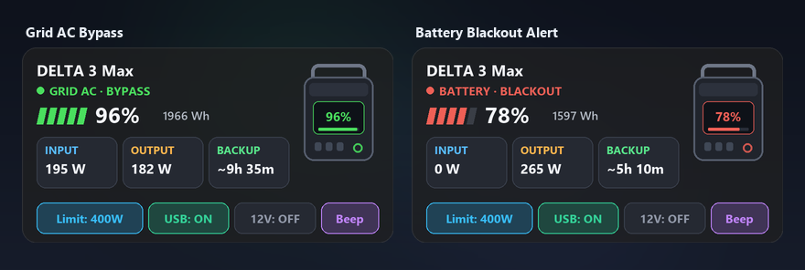
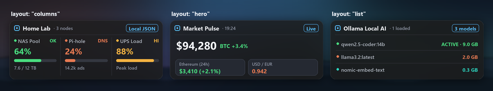

# Полный гайд по настройке всех виджетов StartHub

> **English version:** [docs/WIDGETS.md](WIDGETS.md) · **Темы, цвета и защита плиток:** [docs/CUSTOMIZATION.md](CUSTOMIZATION.md)

Все модули **Tier 1** работают сразу после установки **без единого API-ключа**. Все модули **Tier 2** отключены по умолчанию (`"enabled": false`) и поддерживают переменные окружения `${ENV_VAR}`, чтобы пароли и токены никогда не лежали открытым текстом в `config.json`.

---

## Содержание
1. [Виджеты из коробки (Tier 1, 0 ключей)](#1-виджеты-из-коробки-tier-1-0-ключей)
2. [Android-телефон — ADB, Wi-Fi ADB, scrcpy, авто-буфер фото и SMS/2FA (`phone_adb`)](#2-android-телефон--adb-wi-fi-adb-scrcpy-авто-буфер-фото-и-sms2fa-phone_adb)
3. [EcoFlow DELTA 3 / DELTA 2 — Cloud MQTT и режим `state_file` (`ecoflow`)](#3-ecoflow-delta-3--delta-2--cloud-mqtt-и-режим-state_file-ecoflow)
4. [Лимиты ИИ-агентов, трекер доходов и Custom JSON (`custom_json`)](#4-лимиты-ии-агентов-трекер-доходов-и-custom-json-custom_json)
5. [Умный свет — Philips Hue, Home Assistant и WLED (`philips_hue`)](#5-умный-свет--philips-hue-home-assistant-и-wled-philips_hue)
6. [Задачи и Todoist (`tasks` / `todoist`)](#6-задачи-и-todoist-tasks--todoist)
7. [Сердечко «Любимые треки» Spotify (`spotify_like`)](#7-сердечко-любимые-треки-spotify-spotify_like)
8. [Переключатель паков плиток Start11 (`tile_switcher`)](#8-переключатель-паков-плиток-start11-tile_switcher)

---

## 1. Виджеты из коробки (Tier 1, 0 ключей)

| ID виджета | Что умеет и как управлять | Основные настройки |
|---|---|---|
| `audio_control` | **Клик по динамику:** Mute/Unmute · **Клик по шкале:** громкость 10–100% · **Клик по плашке устройства (`⇄`):** переключение Наушники ⇄ Колонки ⇄ Монитор через нативный Windows Core Audio COM. | Включён по умолчанию, дополнительных библиотек не требует. |
| `system_monitor` | CPU, GPU (**NVIDIA NVML / `nvidia-smi` + AMD/Intel Windows PDH**), температура GPU и RAM. Опрос ставится на паузу, когда меню скрыто. | `poll_interval_sec: 2.0`. Шкала жёлтая `>70%`, красная `>90%`. |
| `storage_network` | Автоопределение дисков (`C:`, `D:`, `E:`) со свободным местом + живая скорость Download / Upload. | `drives: ["auto"]` или вручную `["C:", "D:"]`, `max_drives: 3`. |
| `media_player` | Универсальный Windows SMTC (Spotify, YouTube Music, Tidal, Chrome/Edge, VLC) — обложка, прогресс, Play/Pause/Prev/Next. | `preferred_apps: ["spotify", "ytmusic", "tidal", "music"]`. |
| `peripherals` | Заряд **Bluetooth/BLE** устройств Windows (AirPods, Sony WH-1000, MX Master BT, Keychron), **Xbox/XInput**, **DualSense** (HID или DSX UDP `6969`), **Logitech HID++** (Unifying, Bolt, Lightspeed) + выпадающее меню Bluetooth и тумблер радио. | `auto_hide_offline: true` скрывает отключённые слоты. Для портативной консоли (Steam Deck / Legion Go / Switch): включите `show_handheld: true` и укажите путь `handheld_battery_file` к JSON формата `{"battery": 78, "status": "Discharging", "ts": 1764000000}`. |
| `tasks` | Локальный список задач (`cache/local_tasks.json`): `+` добавляет задачу, клик по кружку закрывает. Автоматически переключается на Todoist, если указать токен. | `mode: "auto" | "local" | "todoist"`. |
| `focus_timer` | Таймер Помодоро 25/5: клик по плашке `Focus`/`Break` меняет фазу, Play/Pause, Reset, счётчик сессий (`×2`), звуковой сигнал. | `work_minutes: 25`, `break_minutes: 5`, `sound_on_done: true`. |
| `weather_card` | Бесплатный Open-Meteo с поиском города по названию (**Настройки → Weather & Peripherals → Search City**). | `show_card: "auto"` скрывает боковую карточку, пока в центре Start11 видна погода, и **автоматически возвращает её в крыло**, если плитки заняли центр. |
| `calendar_card` | Интерактивный календарь на месяц (`‹` / `›`, кнопка `Сегодня`). | Поддерживает русский, украинский и английский. |
| `quick_actions` | До 5 своих кнопок быстрого запуска (`snip`, `terminal`, `lock`, `sleep`, `explorer`, `starthub_settings`, любой URL или команда/программа). | Настраивается мышкой в **Настройки → Custom Cards & Actions**. |

---

## 2. Android-телефон — ADB, Wi-Fi ADB, scrcpy, авто-буфер фото и SMS/2FA (`phone_adb`)

Превращает верх левого крыла в живой пульт управления смартфоном: процент батареи и статус зарядки, **экран телефона в 1 клик через `scrcpy`** (с опциональным автопробуждением и вводом PIN), **моментальный скриншот телефона прямо в буфер обмена Windows (`Ctrl+V`)**, **авто-буфер** (сделал скрин или фото на телефоне → оно само прилетело в буфер ПК!), **галерею последних фото** (ПКМ открывает сразу в Photoshop или любом редакторе) и **опциональный бар SMS / 2FA-кодов** внизу крыла.

### Шаг 1 — Установите `scrcpy` и `adb` на Windows

Откройте PowerShell и выполните:

```powershell
winget install Genymobile.scrcpy
```

Переоткройте PowerShell и проверьте, что обе утилиты доступны (`adb.exe` уже входит в комплект `scrcpy`):

```powershell
adb version
scrcpy --version
```

> Если скачали портативный ZIP `scrcpy` вручную, распакуйте его, например, в `C:\Tools\scrcpy\` и пропишите полные пути в `adb_path` и `scrcpy_path`.

### Шаг 2 — Включите отладку на самом смартфоне

1. Откройте **Настройки → О телефоне** и нажмите **7 раз** по пункту **Номер сборки** (на Xiaomi — **Версия ОС / HyperOS / MIUI**), пока не появится *«Вы стали разработчиком»*.
2. Откройте **Настройки → Для разработчиков** (на Xiaomi: **Расширенные настройки → Для разработчиков**) и включите:
   - **Отладка по USB** (*USB debugging*).
   - **Для Xiaomi / MIUI / HyperOS — ОБЯЗАТЕЛЬНО:** дополнительно включите **Отладка по USB (Настройки безопасности)** (*USB debugging (Security settings)*). Без этого переключателя Xiaomi блокирует команды `adb shell input` — не будут работать клики в `scrcpy`, автосвайп и автоввод PIN!
3. Подключите телефон кабелем USB и выполните:
   ```powershell
   adb devices
   ```
4. На экране телефона поставьте галочку **«Всегда разрешать для этого компьютера»** и нажмите **Разрешить**.
5. Узнайте серийный номер устройства (нужен для надёжного автопереподключения по Wi-Fi):
   ```powershell
   adb shell getprop ro.serialno
   ```

### Шаг 3 — Включите беспроводной Wi-Fi ADB (без кабеля!)

Пока телефон ещё на проводе, откройте порт `5555` одной командой:

```powershell
adb tcpip 5555
```

Посмотрите локальный IP телефона (**Настройки → Wi-Fi → ваша сеть → IP-адрес**, например `192.0.2.42`) и подключитесь по Wi-Fi:

```powershell
adb connect <IP_ТЕЛЕФОНА>:5555
adb devices
```

Отключайте кабель! Теперь всё работает по Wi-Fi.

- **Умный автопоиск StartHub:** если указать и `device_serial`, и `wifi_address`, StartHub сам пробует `adb mdns services`, кэшированный IP и даже сканирует порт `5555` в вашей подсети `/24`, если роутер выдал телефону новый адрес.
- **Совет:** закрепите за телефоном **статический IP (DHCP Reservation)** в настройках роутера — тогда адрес никогда не изменится.
- **Важно после перезагрузки телефона:** Android сбрасывает `adb tcpip 5555` после полного ребута смартфона — достаточно на 2 секунды воткнуть провод и снова выполнить `adb tcpip 5555` (либо подключаться через *Беспроводную отладку* Android 11+).

### Шаг 4 — Пропишите параметры в GUI или `config.json`

Включите **Android Phone Hub** в **Настройки → Widgets & Layout** и заполните поля в **Настройки → Integrations**, либо добавьте в `config.json`:

```json
"phone_adb": {
  "enabled": true,
  "device_name": "Pixel 9 Pro",
  "adb_path": "adb",
  "scrcpy_path": "scrcpy",
  "device_serial": "${PHONE_ADB_SERIAL}",
  "wifi_address": "<IP_ТЕЛЕФОНА>:5555",
  "unlock_pin": "${PHONE_UNLOCK_PIN}",
  "enable_sms_otp": false,
  "enable_photos": true,
  "auto_clip_sync": true,
  "frame_image_path": "assets/my_phone.png",
  "image_editor_path": "C:\\Program Files\\Adobe\\Adobe Photoshop 2025\\Photoshop.exe"
}
```

#### Разбор всех фишек

- **`frame_image_path` (своя картинка телефона):** укажите путь к любому вертикальному `.png`/`.jpg` (рендер вашего телефона или просто красивая картинка/обои) — она отобразится в мини-превью смартфона слева от кнопок.
- **`unlock_pin` (авторазблокировка при открытии экрана):** если задать переменную `setx PHONE_UNLOCK_PIN "1234"` и указать `"${PHONE_UNLOCK_PIN}"`, кнопка **Экран** сама разбудит телефон, сделает свайп вверх и введёт PIN. Оставьте `""`, если хотите разблокировать вручную.
- **`auto_clip_sync` (авто-буфер фото/скринов):** пока развёрнут блок «Фото с мобилы», любой новый скриншот или снимок на телефоне автоматически скачивается и копируется в буфер обмена Windows — сразу жмите `Ctrl+V` в Telegram, Photoshop или браузере!
- **`image_editor_path` (ПКМ → Photoshop):** ЛКМ по фото в виджете копирует его в буфер обмена, а **ПКМ** открывает файл напрямую в указанном редакторе (или стандартном просмотрщике Windows, если оставить пустым).
- **`enable_sms_otp` (бар SMS и 2FA-кодов):** по умолчанию `false`. При включении читает входящие SMS через `adb shell content query --uri content://sms/inbox`, сам вытаскивает 4–8-значный код подтверждения и закрепляет внизу левого крыла кнопку **«Код: 354081»** (копируется в 1 клик) + выдвижную шторку на 4 последних SMS. *(На части жёстких прошивок Android 14/15 доступ к `content://sms/inbox` по ADB может быть закрыт — тогда просто оставьте `false`.)*

---

## 3. EcoFlow DELTA 3 / DELTA 2 — Cloud MQTT и режим `state_file` (`ecoflow`)

Живая телеметрия зарядной станции в правом крыле: статус **СЕТЬ · БАЙПАС** (зелёный) против **БАТАРЕЯ · БЛЭКАУТ** (красный алерт, который сохраняется даже в монохромной теме `single_accent`), 5-сегментный индикатор заряда, остаток в Вт·ч, Вход / Выход / расчётный резерв и **прямые кнопки управления** (лимит зарядки, USB, 12V, звук).



### Шаг 1 — Поставьте опциональные пакеты

Для Cloud MQTT нужны `paho-mqtt` и `protobuf`:

```powershell
.\install.ps1 -Optional
```

### Шаг 2 — Безопасно задайте логин/пароль через переменные окружения

Выполните один раз в PowerShell (после чего перезапустите StartHub):

```powershell
setx ECOFLOW_EMAIL "ваш_email@example.com"
setx ECOFLOW_PASSWORD "ваш_пароль_ecoflow"
# Необязательно — если не задавать, StartHub сам найдёт первую привязанную станцию:
setx ECOFLOW_DEVICE_SN "СЕРИЙНЫЙ_НОМЕР_СТАНЦИИ"
```

> Либо впишите данные напрямую в **Настройки → Integrations → EcoFlow** (`config.json` добавлен в `.gitignore`).

### Шаг 3 — Настройте регион, картинку станции и шаги зарядки

Включите **EcoFlow Power Station** в **Настройки → Widgets & Layout** и проверьте `config.json`:

```json
"ecoflow": {
  "enabled": true,
  "mode": "mqtt",
  "email": "${ECOFLOW_EMAIL}",
  "password": "${ECOFLOW_PASSWORD}",
  "device_sn": "${ECOFLOW_DEVICE_SN}",
  "device_name": "DELTA 3 Max",
  "region": "europe",
  "image_path": "assets/delta3.png",
  "charge_watt_steps": [200, 400, 600, 800, 1000, 1500]
}
```

- **`region`:** для аккаунтов Украины и Европы — `"europe"` (`api-e.ecoflow.com`); для США / Global — `"us"` (`api.ecoflow.com`). Если не логинится — в 90% случаев нужно поменять именно `region`.
- **`image_path`:** укажите путь к прозрачному `.png` вашей станции — она красиво встанет в правый верхний угол карточки (как на скриншоте!).
- **Кнопки управления внизу карточки:**
  - **Лимит (Вт)** — циклически переключает мощность AC-зарядки по массиву `charge_watt_steps`.
  - **USB / 12V / Звук** — включает/выключает соответствующие выходы и пищалку по защищённому TLS MQTT (`8883`).
- **Логи:** пишутся в `cache/logs/ecoflow.log` с жёсткой ротацией 2 МБ (не засоряют диск).

### Альтернатива: режим `state_file` (для Home Assistant или своего моста)

Если у вас уже работает свой скрипт опроса EcoFlow или Home Assistant, поставьте `"mode": "state_file"` и укажите пути к `state_file` / `command_file` — StartHub будет читать готовый JSON каждые 2.5 сек и записывать команды кнопок атомарно в `command_file` (`{"chg_pow_max": 600}`, `{"usb_open": 1}`, `{"dc_out_open": 0}`, `{"en_beep": 0}`). Полный формат JSON — в [docs/WIDGETS.md](WIDGETS.md#alternative-external-state_file--command_file-mode-home-assistant--custom-bridge).

---

## 4. Лимиты ИИ-агентов, трекер доходов и Custom JSON (`custom_json`)

Универсальный виджет **Custom JSON** позволяет за 2 минуты вывести в крыло **любые ваши метрики** в одном из 3 нативных макетов (`columns`, `hero`, `list`) — из локального JSON-файла или локального HTTP-сервера (`http://127.0.0.1:...`).



### А. Карточка лимитов ИИ-агентов (Claude Code / Codex / Gemini / OpenRouter) — макет `columns`

1. В репозитории уже лежит готовый скрипт **[`examples/custom_json/ai_quotas_example.py`](../examples/custom_json/ai_quotas_example.py)**. Запустите его один раз:
   ```powershell
   .\.venv\Scripts\python.exe examples\custom_json\ai_quotas_example.py
   ```
   - Если задать `setx OPENROUTER_API_KEY "sk-or-..."`, первая колонка **автоматически подтянет реальный остаток кредитов OpenRouter**.
   - Для **Claude Code / Codex / Gemini / Antigravity** вы можете либо писать свои числа в `cache/ai_quotas_raw.json`, либо генерировать `cache/custom_ai_quotas.json` напрямую из своего скрипта в таком формате:

```json
{
  "title": "AI Agent Quotas",
  "subtitle": "14:30",
  "badge": "3 tools",
  "layout": "columns",
  "url": "https://openrouter.ai/activity",
  "metrics": [
    { "label": "Claude Code", "value": "24%", "percent": 24, "sublabel": "Сброс 18:00", "tag": "5ч",  "status": "ok" },
    { "label": "Codex CLI",   "value": "78%", "percent": 78, "sublabel": "Неделя",      "tag": "7д",  "status": "warn" },
    { "label": "Gemini",      "value": "94%", "percent": 94, "sublabel": "Остаток",     "tag": "Pro", "status": "ok" }
  ]
}
```

2. Добавьте карточку через **Настройки → Custom Cards & Actions → Custom JSON Cards** (кнопка **Add / Update Card**), указав `Source = cache/custom_ai_quotas.json`, `Layout = columns`, `Refresh = 30`.
3. Можно добавить **сколько угодно карточек** подряд — например, отдельно Claude + Codex, отдельно Antigravity/Gemini и отдельно Доходы!

### Б. Трекер доходов / бюджета / цели — макет `hero`

В репозитории есть готовый скрипт **[`examples/custom_json/income_budget_example.py`](../examples/custom_json/income_budget_example.py)** — рисует крупную сумму за месяц + две плашки внизу (**В среднем / день** и **Прогноз на месяц**):

```powershell
# Создать стартовую карточку:
.\.venv\Scripts\python.exe examples\custom_json\income_budget_example.py

# Быстро добавить запись и сразу обновить виджет:
.\.venv\Scripts\python.exe examples\custom_json\income_budget_example.py --add 350 --note "Дизайн"
```

Подключите в **Custom JSON Cards**: `Source = cache/custom_budget.json`, `Layout = hero`.

### В. Автообновление скриптов в фоне через Планировщик задач Windows

Выполните один раз в PowerShell из папки StartHub — скрипт будет тихо обновлять JSON каждые 5 минут через `pythonw.exe` (без всплывающих чёрных окон):

```powershell
$Repo = (Get-Location).Path
$Action = New-ScheduledTaskAction -Execute "$Repo\.venv\Scripts\pythonw.exe" -Argument "`"$Repo\examples\custom_json\ai_quotas_example.py`"" -WorkingDirectory $Repo
$Trigger = New-ScheduledTaskTrigger -Once -At (Get-Date) -RepetitionInterval (New-TimeSpan -Minutes 5) -RepetitionDuration (New-TimeSpan -Days 3650)
Register-ScheduledTask -TaskName "StartHub-AI-Quotas" -Action $Action -Trigger $Trigger -Force
```

> Либо укажите в `source` локальный URL вроде `"http://127.0.0.1:8080/quotas.json"` — StartHub будет опрашивать его сам каждые `refresh_sec` секунд, пока меню открыто.

---

## 5. Умный свет — Philips Hue, Home Assistant и WLED (`philips_hue`)

Карточка умного света **не привязана только к Philips Hue**! Выбирайте один из **3 встроенных локальных бэкендов** (`backend`), подключайте **от 1 до 4 комнат/ламп/розеток** (для 3–4 устройств автоматически включается компактная сетка 2×2) и управляйте яркостью 10-шаговым диммером. **ЛКМ** включает/выключает плитку, **ПКМ по любой плитке** переключает нижний диммер именно на эту лампу/комнату!

### Вариант А — Home Assistant (`backend: "home_assistant"`) — ЛЮБОЙ умный дом!
Работает со всем, что подключено к Home Assistant: **Xiaomi / Yeelight, Tuya / Smart Life, Aqara, IKEA Tradfri, TP-Link Tapo/Kasa, Govee, Nanoleaf, LIFX, Zigbee2MQTT, ESPHome, Matter**, а также умные розетки и выключатели (`switch.*`).

1. В Home Assistant откройте свой профиль (снизу слева) → **Безопасность → Долгосрочные токены доступа → Создать токен**.
2. Сохраните токен: `setx HA_TOKEN "ваш_токен"` (или вставьте в **Настройки → Integrations → Smart Lights**).
3. Выберите **Backend = `home_assistant`**, укажите **HA URL** (например `http://homeassistant.local:8123` или `http://<IP_СЕРВЕРА>:8123`) и **HA Token**, нажмите **Load Lights** — отметьте до 4 сущностей `light.*` / `switch.*` и нажмите **Apply & Save**!

```json
"philips_hue": {
  "enabled": true,
  "backend": "home_assistant",
  "ha_url": "http://homeassistant.local:8123",
  "ha_token": "${HA_TOKEN}",
  "targets": [
    { "id": "light.office_ceiling", "label": "Кабинет",    "icon": "bulb",    "dimmer": true },
    { "id": "light.monitor_strip",  "label": "За экраном", "icon": "monitor", "dimmer": false },
    { "id": "switch.desk_plug",     "label": "Розетка",    "icon": "monitor", "dimmer": false }
  ]
}
```

### Вариант Б — Philips Hue Bridge (`backend: "hue"`, локальный LAN HTTPS)
1. Откройте **Трей → Настройки → Integrations (Tier 2) → Smart Lights** (**Backend = `hue`**).
2. Нажмите **Find Hue** (или впишите локальный IP моста вручную).
3. Нажмите **физическую круглую кнопку Link** на самом Philips Hue Bridge и в течение 30 секунд нажмите **Pair Hue** — `app_key` заполнится сам.
4. Нажмите **Load Lights**, отметьте галочками до 4 комнат/ламп и нажмите **Apply & Save**!

### Вариант В — WLED Wi-Fi ленты (`backend: "wled"`, вообще без токенов!)
Идеально для подсветки за монитором или столом на прошивке [WLED](https://kno.wled.ge/) — не нужен ни хаб, ни токен, только локальный IP ленты:

```json
"philips_hue": {
  "enabled": true,
  "backend": "wled",
  "bridge_ip": "<IP_WLED>",
  "targets": [
    { "id": "<IP_WLED>", "kind": "wled", "label": "Подсветка LED", "icon": "monitor", "dimmer": true }
  ]
}
```

---

## 6. Задачи и Todoist (`tasks` / `todoist`)

- **Офлайн из коробки:** работает сразу без аккаунта (`cache/local_tasks.json`). Нажмите `+` для добавления задачи и кликните по кружку для закрытия.
- **Синхронизация с Todoist (REST API v1):**
  1. В Todoist откройте **Настройки → Интеграции → Для разработчиков** и скопируйте **API-токен**.
  2. Выполните `setx TODOIST_API_TOKEN "ваш_токен"` (или вставьте токен в **Настройки → Integrations → Todoist Token**).
  3. Оставьте `"projects": []` — все ваши проекты подтянутся автоматически, переключаться между ними можно кликом по заголовку карточки.

---

## 7. Сердечко «Любимые треки» Spotify (`spotify_like`)

Сам плеер работает со Spotify сразу без ключей через Windows SMTC. Чтобы дополнительно работала кнопка **♥ (добавить/убрать из «Любимых треков»)**:

1. Откройте [Spotify Developer Dashboard](https://developer.spotify.com/dashboard) → **Create App**.
2. В поле **Redirect URI** добавьте точно этот адрес:
   ```text
   http://127.0.0.1:43827/callback
   ```
3. Скопируйте **Client ID** (32 символа; Client Secret не нужен — используется PKCE OAuth).
4. Выполните один раз в PowerShell:
   ```powershell
   .\.venv\Scripts\python.exe -m starthub.providers.spotify_like --auth --client-id ВАШ_32_СИМВОЛЬНЫЙ_CLIENT_ID
   ```
5. Подтвердите доступ в браузере, пропишите `setx SPOTIFY_CLIENT_ID "..."` и включите `widgets.media_player.spotify_like.enabled: true`.

---

## 8. Переключатель паков плиток Start11 (`tile_switcher`)

Позволяет в 1 клик менять оформление всех кастомных иконок плиток Start11 (например, *Минимал*, *Аниме*, *Неон*) с автобекапом реестра `.reg` и откатом при ошибке.

### Самый быстрый способ — выгрузить текущие плитки одной командой (`--export`)

1. Настройте картинки плиток прямо в Start11 мышкой (**ПКМ по плитке → Выбрать изображение плитки**).
2. Выполните одну команду — StartHub сам прочитает ветку `CustomTiles` из реестра, скопирует картинки и создаст готовый `pack.json`:
   ```powershell
   .\.venv\Scripts\python.exe tools\tile_switcher.py --export my_pack --name "Мой пак"
   ```
   *(Повторите для второго набора, например `--export minimal --name "Минимал"`; для перезаписи существующего пака добавьте `--overwrite`.)*
3. Включите **Start11 Tile Switcher** в **Настройки → Widgets & Layout**. Если виджет **Tasks** включён, кнопка переключения паков появится в его шапке; если выключен — отобразится отдельной компактной панелью.

### Ручной формат `pack.json`

Каждый пак лежит в `packs/<название>/pack.json` (пример: [`packs/example_minimal/`](../packs/example_minimal/)):
```json
{
  "name": "Minimal",
  "description": "Минималистичные иконки плиток",
  "tiles": {
    "C:\\ProgramData\\Microsoft\\Windows\\Start Menu\\Programs\\Windows PowerShell\\Windows PowerShell.lnk": "sample_terminal.png"
  }
}
```
